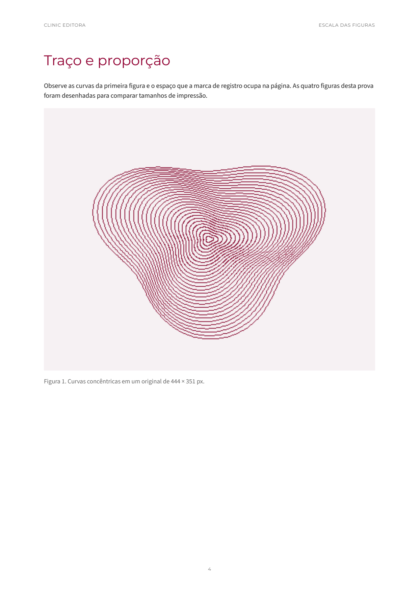
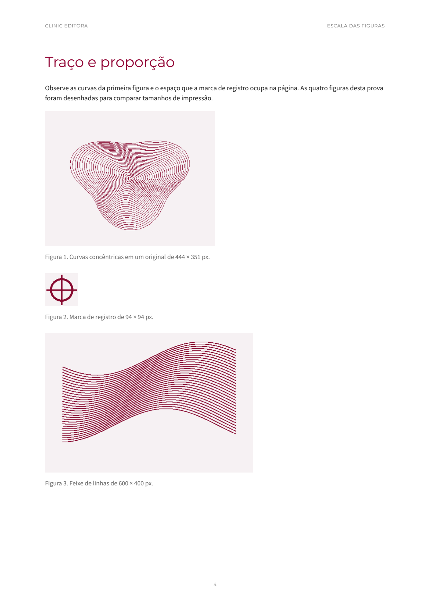

# Tamanho das figuras na página impressa

**Recomendo aprovar o tamanho de origem para as figuras herdadas e o piso de 150 ppi para as que chegam sem registro de origem.** Na página 4, a figura de curvas passa de 166,0 para 82,9 mm de largura. O ícone e o feixe de linhas passam a caber abaixo dela, cada um com sua legenda.

| Antes · página 4 | Depois · página 4 |
| --- | --- |
|  |  |

As prévias mostram a folha A4 inteira na mesma escala. Clique em cada uma para ampliá-la. A prancha vertical, quarta figura da prova, passa da página 7 para a 5. O manuscrito sintético completo passa de **7 para 5 páginas**, incluindo capa, expediente e sumário.

## Medidas no PDF

| Figura e arquivo de entrada | PPI de origem | Largura antes → depois | PPI efetivo antes → depois | Página antes → depois |
| --- | ---: | ---: | ---: | ---: |
| 1. Curvas, 444 × 351 px | 136 | 166,0 → 82,9 mm | 67,9 → 136,0 | 4 → 4 |
| 2. Marca de registro, 94 × 94 px | Sem registro | 166,0 → 15,9 mm | 14,4 → 150,0 | 5 → 4 |
| 3. Feixe de linhas, 600 × 400 px | Sem registro | 166,0 → 101,6 mm | 91,8 → 150,0 | 6 → 4 |
| 4. Prancha vertical, 1122 × 1402 px | 300 | 166,0 → 95,0 mm | 171,7 → 300,0 | 7 → 5 |

## Regra para aprovação

A largura proposta em polegadas é a largura em pixels dividida pelo PPI de origem registrado em `origem.json`. Para uma figura sem registro, a divisão usa `error_ppi` de `shared/rules/graphic-rules.json` (150 nesta prova). A coluna limita a largura máxima a 100%, e a altura acompanha a proporção da imagem. A borda esquerda continua alinhada ao texto, com a legenda logo abaixo.

A figura 1 conserva os 136 ppi do original e continua abaixo da faixa recomendada de 300 ppi. A marca de registro fica com 15,9 mm de largura. Se o detalhe de uma figura exigir mais espaço para a leitura, a recomendação editorial é pedir um arquivo com mais pixels.

**Decisão do Alify:** aprovar essa regra de tamanho para a implementação no Diagramador?

## Como reproduzir

Na raiz do repositório, execute `uv run --locked python scripts/render_figure_samples.py`. O script desenha as quatro figuras, compõe o mesmo manuscrito duas vezes com `build_book.py` e aplica as larguras propostas numa cópia temporária dos assets. Ele informa as páginas e mede o PPI efetivo dividindo os pixels pela dimensão impressa em polegadas, usando o menor valor entre os dois eixos. Os PNGs são exportados a 150 ppi a partir da página 4 de cada PDF.
