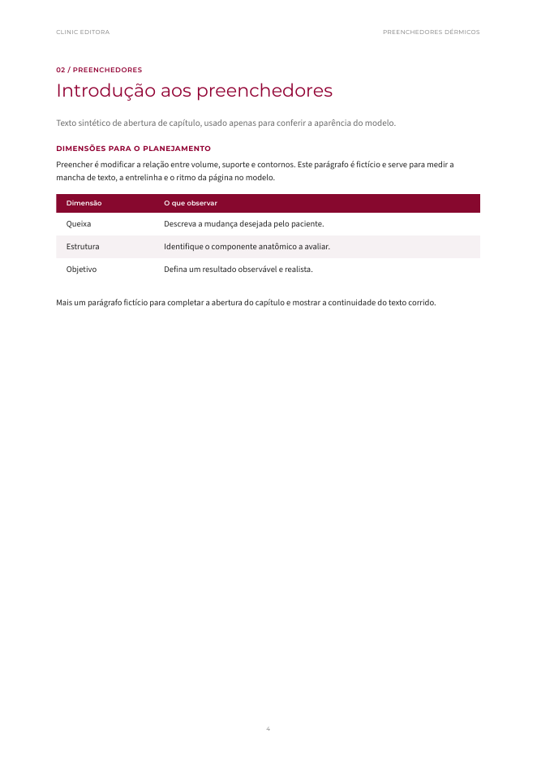
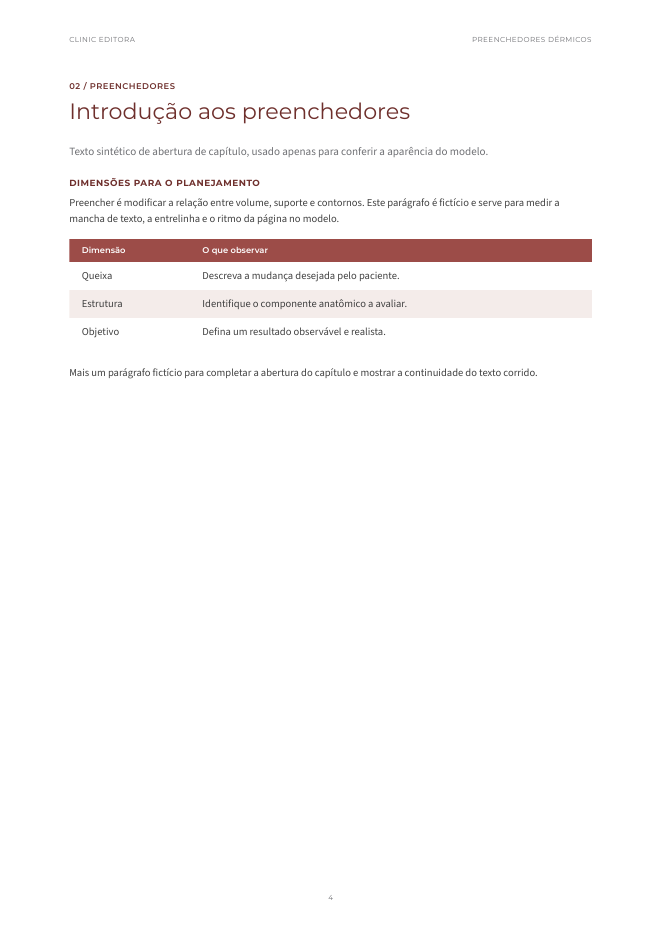
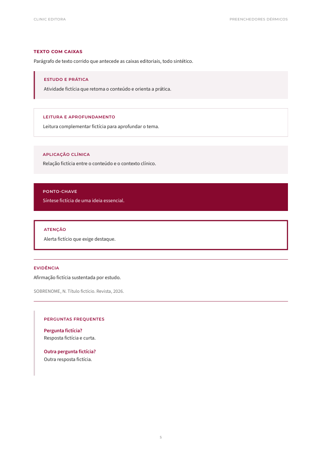
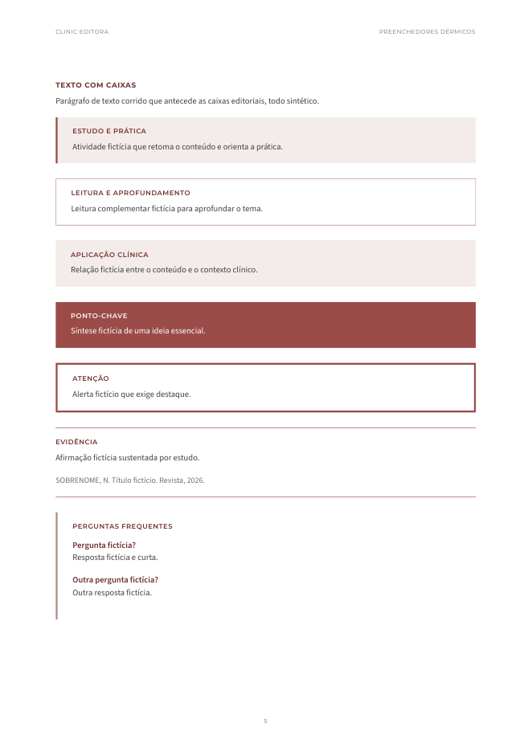
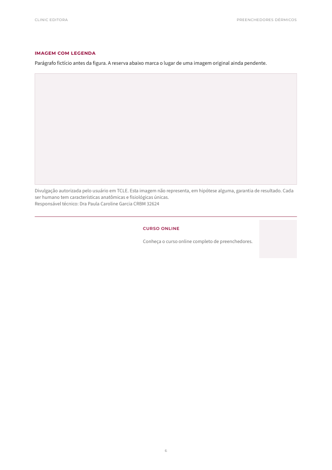
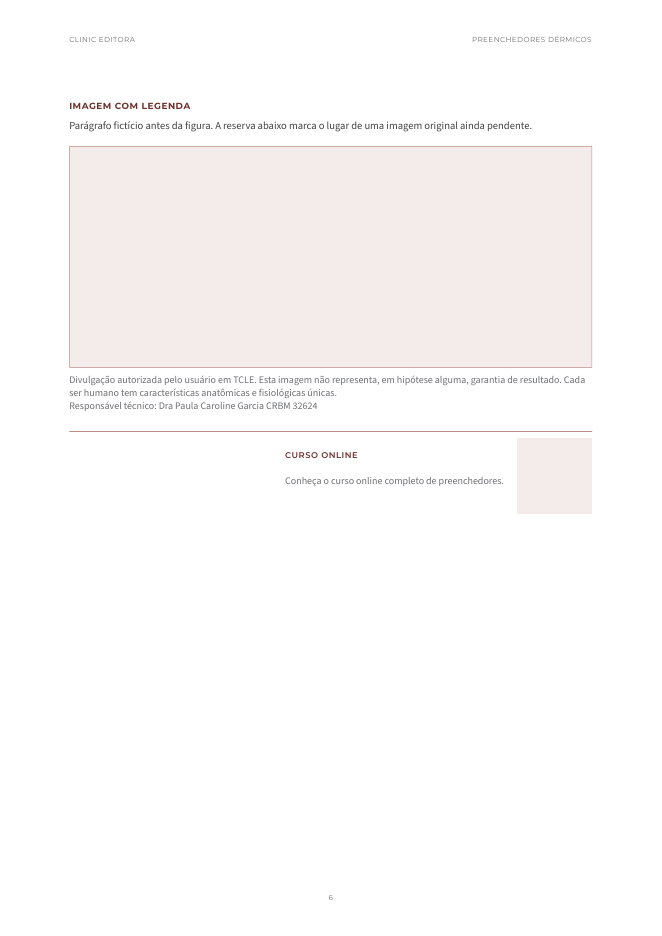

# Comparação de paletas do livro

As duas versões usam a mesma amostra sintética, com o mesmo conteúdo, a mesma tipografia e a mesma diagramação.

| Página | Paleta atual (bordô) | Paleta do logo (vinho) |
| --- | --- | --- |
| Abertura de capítulo |  |  |
| Texto com caixas |  |  |
| Imagem com legenda |  |  |

## Cores trocadas

Cores da seção Identidade visual do [design system da Julie](../../fontes/2026-11-19-julie-design-system/design-system-aulas-clinic-cursos.html#identidade).

| Token | Paleta atual | Paleta do logo |
| --- | --- | --- |
| `--color-brand` | `#87082e` | `#9C4C48` |
| `--color-heading` | `#910032` | `#6E2F2C` |
| `--color-text` | `#232323` | `#404040` |
| `--color-muted` | `#6b6b6b` | `#6E6F73` |
| `--color-header` | `#727272` | `#6E6F73` |
| `--color-tint` | `#f6f1f3` | `#F4ECEA` |
| `--color-rule` | `#d9c7ce` | `#B68B85` |

O branco do papel e do texto sobre fundos de marca é o mesmo nas duas versões.

Para recriar as imagens e esta comparação, execute `uv run --locked python scripts/render_palette_samples.py` na raiz do repositório. O script usa o `pdftoppm` do Poppler para gerar os PNGs.
